<!-- COVER -->
**ĐẠI HỌC BÁCH KHOA HÀ NỘI**

**BÁO CÁO BÀI TẬP LỚN GIỮA KỲ**
**HỌC PHẦN: HỆ ĐIỀU HÀNH**
**NỀN TẢNG THỰC THI EDGE-AI KHÔNG ĐỒNG NHẤT**
*Heterogeneous Edge-AI Runtime*
Nhóm thực hiện: 3 Stars
| Họ và tên | MSSV | Phân công |
|---|---|---|
| Nguyễn Quốc Khánh (nhóm trưởng) | 20233464 | Kiến trúc; pipeline Linux (camera/inference/bridge); thiết kế/chạy kiểm thử Raspberry Pi 5; tổng hợp báo cáo. |
| Nguyễn Trung Hiếu | 20233398 | Cấu hình Linux (ưu tiên/ghim CPU/tạo tải); đo đánh thức timer; tìm hiểu cơ sở lý thuyết. |
| Nguyễn Quang Vinh | 20233718 | Firmware STM32/FreeRTOS (nhận UART/giám sát/LED); khung UART; lắp và đấu nối bàn thử. |
Giảng viên hướng dẫn: TS. Nguyễn Quang Minh
Mã lớp bài tập: 173876
Hà Nội, 10/2026
<!-- PAGE -->
<!-- ABSTRACT -->
Báo cáo giữa kỳ đến ngày 31/10/2026 trình bày nền tảng Edge-AI đang trong quá trình triển khai. Raspberry Pi chạy Ubuntu xử lý suy luận; STM32 chạy FreeRTOS giám sát qua UART. Nhóm khảo sát lập lịch, tranh chấp tài nguyên và hàng đợi. Kết quả sơ bộ: OS-T1/OS-T2 PASS; OS-T3/OS-T4 FAIL theo tiêu chí đã định. Dữ liệu cho thấy ưu tiên CPU chưa cô lập được tranh chấp nhớ và vị trí loại đầu vào cũ ảnh hưởng đến tuổi dữ liệu. Các phép đo phần mềm và phản ứng GPIO được phân biệt với kết quả UART vật lý.

**Từ khóa:** hệ điều hành; Linux; FreeRTOS; UART; lập lịch; tuổi dữ liệu; giám sát độc lập.
<!-- PAGE -->
<!-- TOC -->
<!-- PAGE -->
<!-- GLOSSARY -->

| Viết tắt | Tiếng Anh đầy đủ | Giải thích |
|---|---|---|
| AI | Artificial Intelligence | Trí tuệ nhân tạo. |
| AoI | Age of Information | Tuổi dữ liệu hữu ích mới nhất. |
| CPU | Central Processing Unit | Bộ xử lý trung tâm. |
| CRC | Cyclic Redundancy Check | Mã kiểm tra dư vòng. |
| CSI | Camera Serial Interface | Giao tiếp nối tiếp camera. |
| DMA | Direct Memory Access | Truyền trực tiếp ngoại vi–bộ nhớ. |
| FIFO | First In, First Out | Vào trước, ra trước. |
| GND/VCC | Ground / Supply voltage | Mass chung / điện áp cấp nguồn. |
| GPIO | General-Purpose Input/Output | Chân vào/ra số đa dụng. |
| I2C | Inter-Integrated Circuit | Giao tiếp nối tiếp liên mạch. |
| IMU | Inertial Measurement Unit | Bộ đo quán tính. |
| IPC | Inter-Process Communication | Giao tiếp giữa các tiến trình. |
| IRQ | Interrupt Request | Yêu cầu ngắt. |
| ISR | Interrupt Service Routine | Hàm phục vụ ngắt. |
| LED | Light-Emitting Diode | Điốt phát quang. |
| MCU | Microcontroller Unit | Vi điều khiển. |
| ONNX | Open Neural Network Exchange | Định dạng trao đổi mô hình. |
| OS | Operating System | Hệ điều hành. |
| P50/P95/P99 | 50th / 95th / 99th percentile | Các phân vị 50, 95, 99. |
| PTY | Pseudo-terminal | Thiết bị đầu cuối giả. |
| RAM | Random Access Memory | Bộ nhớ truy cập ngẫu nhiên. |
| RTOS | Real-Time Operating System | Hệ điều hành thời gian thực. |
| RTT | Round-Trip Time | Thời gian khứ hồi. |
| RX/TX | Receive / Transmit | Nhận / phát dữ liệu. |
| SCL/SDA | Serial Clock Line / Serial Data Line | Đường xung nhịp / dữ liệu I2C. |
| SOF | Start of Frame | Dấu bắt đầu khung. |
| UART | Universal Asynchronous Receiver-Transmitter | Bộ thu phát nối tiếp bất đồng bộ. |
| USART | Universal Synchronous/Asynchronous Receiver-Transmitter | Bộ thu phát đồng bộ/bất đồng bộ. |

# PHẦN 1. GIỚI THIỆU

## 1.1 Động lực và bài toán

Khi CPU bận hoặc hàng đợi dài, ảnh có thể đã cũ trước khi tới nơi sử dụng. Vì vậy, ngoài thông lượng, hệ thống cần biết tuổi kết quả và cách phản ứng khi mất cập nhật.

Nhóm dùng Raspberry Pi 5 chạy Ubuntu Server 24.04 ARM64 để xử lý ảnh và STM32F446RE chạy FreeRTOS để giám sát qua UART. Suy luận tạo tải để khảo sát hệ điều hành; STM32 giám sát hoạt động và tuổi kết quả. Đề tài không đánh giá độ chính xác mô hình.

## 1.2 Câu hỏi nghiên cứu

Nhóm tìm hiểu tải cạnh tranh làm thời gian xử lý và chuyển giao thay đổi thế nào. Việc tăng độ ưu tiên, gắn công việc vào lõi CPU và giữ trang nhớ trong RAM có giảm độ trễ không? Khi xử lý không kịp nguồn ảnh, nên giữ thứ tự FIFO hay bỏ dữ liệu cũ, và nên bỏ ở khâu nào? Cuối cùng, khi Pi ngừng cung cấp kết quả, STM32 mất bao lâu để phát hiện và chuyển đầu ra sang trạng thái an toàn mô phỏng?

LED chỉ mô phỏng đầu ra, chưa điều khiển cơ cấu chấp hành.

# PHẦN 2. CƠ SỞ LÝ THUYẾT VÀ CÁC CÔNG TRÌNH LIÊN QUAN

## 2.1 Lập lịch và tranh chấp tài nguyên

Bộ lập lịch quyết định công việc nào được dùng CPU khi nhiều công việc cùng sẵn sàng. Chính sách mặc định chia sẻ CPU; SCHED_FIFO cho phép luồng có độ ưu tiên cao chạy trước, nhưng có thể khiến công việc khác thiếu thời gian xử lý [1]. Gắn luồng vào một lõi và giữ trang nhớ trong RAM giúp giảm một số nguồn chờ, nhưng các lõi vẫn dùng chung bộ nhớ và bộ nhớ đệm.

Vì vậy, ưu tiên CPU chưa đủ để bảo đảm thời gian suy luận khi tải khác chiếm băng thông bộ nhớ. MemGuard nghiên cứu cách dành riêng băng thông nhớ [2]; báo cáo dùng công trình này để giải thích giới hạn, không triển khai cơ chế đó.

## 2.2 PREEMPT_RT

PREEMPT_RT giảm những đoạn nhân Linux không thể bị chiếm quyền, nhằm cải thiện khả năng đáp ứng. Cấu hình P3 dự kiến dùng Real-time Ubuntu đóng gói sẵn. Các kết quả hiện có dùng nhân tiêu chuẩn, nên chưa cho phép kết luận về P3.

## 2.3 Tuổi dữ liệu

AoI là tuổi của dữ liệu hữu ích mới nhất mà bên nhận đang giữ [3], [4]. Tuổi tăng khi không có cập nhật và giảm khi nhận kết quả mới. Nó không về 0 vì ảnh đã mất thời gian chờ, xử lý và truyền.

AoI trung bình được tính từ diện tích dưới đường tuổi chia cho thời gian quan sát, kể cả lúc ngừng nhận. Trung bình độ trễ của các gói đã tới không thể thay thế nó, vì bỏ qua khoảng không có gói.

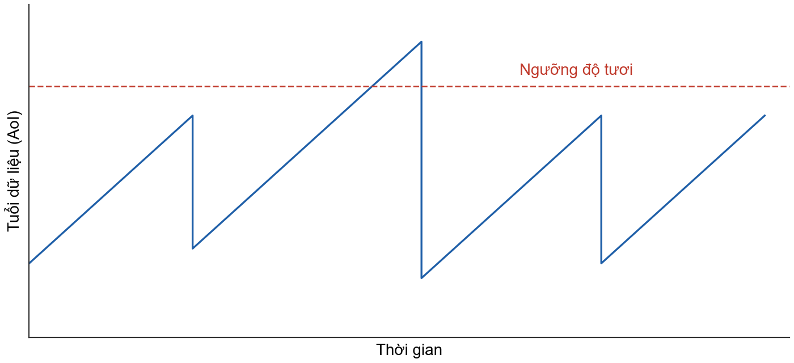

## 2.4 Simplex và FreeRTOS

Simplex tách khối tính toán phức tạp khỏi khối quyết định đầu ra [5], [6]. Trong bàn thử, Pi đề xuất kết quả còn STM32 quyết định có tiếp tục sử dụng hay không.

FreeRTOS lập lịch theo độ ưu tiên cố định và cho phép chiếm quyền. Tác vụ vẫn có thể trễ nếu ngắt bị che hoặc công việc trước kéo dài.

# PHẦN 3. THIẾT KẾ HỆ THỐNG

## 3.1 Kiến trúc và quyền điều khiển

Ảnh được xử lý trên Pi, kết quả đi qua bridge rồi truyền bằng UART tới STM32. Phía STM32 nhận dữ liệu, kiểm tra tính hợp lệ và chuyển cho khối giám sát quyết định trạng thái LED.

Bridge báo còn hoạt động riêng với bản tin kết quả, vì tiến trình vẫn có thể chạy trong khi suy luận đã ngừng cập nhật. Bàn thử chưa có cơ cấu chấp hành hoặc watchdog phần cứng độc lập.

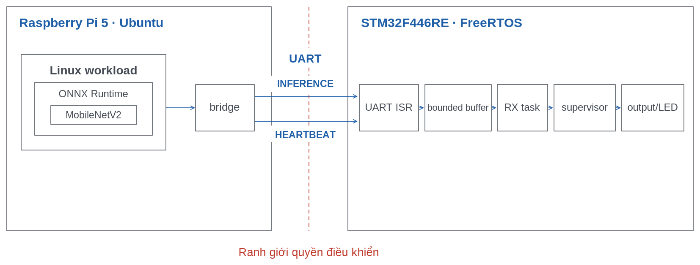

## 3.2 Khung UART

UART truyền từng byte nên bên nhận cần nhận ra ranh giới bản tin và phát hiện dữ liệu hỏng. Bộ phân tích tìm dấu bắt đầu khung, kiểm độ dài và CRC trước khi chuyển dữ liệu cho khối giám sát. Số thứ tự giúp phát hiện bản tin cũ, trùng hoặc mất; một khung đúng CRC vẫn chưa bảo đảm kết quả đủ mới hay suy luận đúng.

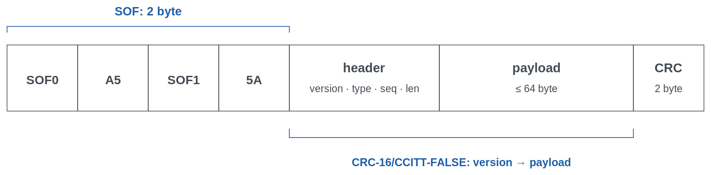

Bảng 1. Thành phần và vai trò của khung UART.
| Thành phần | Vai trò |
|---|---|
| SOF | Dấu bắt đầu để bên nhận tìm ranh giới khung. |
| Phiên bản và loại bản tin | Phân biệt cách giải mã và mục đích bản tin. |
| Số thứ tự và độ dài | Phát hiện gián đoạn, xác định phần dữ liệu cần đọc. |
| Dữ liệu | Mang kết quả hoặc thông tin giám sát; tối đa 64 byte. |
| CRC | Kiểm tra toàn vẹn nội dung khung. |

Ngoài kết quả và tín hiệu còn hoạt động, hai phía trao đổi phản hồi để đối chiếu đồng hồ. STM32 gửi trạng thái và thời điểm chuyển trạng thái để phục vụ đánh giá.

## 3.3 Trạng thái và phiên

INIT giữ đầu ra ở mức an toàn mô phỏng khi chưa đủ điều kiện chạy. RUN, cũng gọi là FRESH, cho phép dùng kết quả khi bridge còn hoạt động và dữ liệu còn mới. HOLD ngừng cập nhật đầu ra khi kết quả quá cũ. FAILSAFE được chốt lại, nên lưu lượng phục hồi chưa làm hệ thống tự chạy tiếp.

Mỗi lần bridge khởi động được phân biệt bằng một phiên mới để dữ liệu chờ từ lần trước không được dùng lại. Khối giám sát kiểm tra hết hạn trước khi nhận cập nhật; phần tái kích hoạt trên bo chưa hoàn tất và chưa tự động thực hiện từ xa.

## 3.4 FIFO và latest-value

FIFO giữ thứ tự đến, phù hợp khi cần xử lý đủ dữ liệu. Nếu nguồn nhanh hơn khả năng phục vụ, dữ liệu có thể phải chờ ngày càng lâu. Latest-value chỉ giữ dữ liệu chờ mới nhất, còn suy luận đang chạy vẫn hoàn tất [4].

Vị trí áp dụng quyết định phần thời gian chờ có thể loại bỏ. Dùng latest-value tại bridge chỉ bỏ kết quả chờ gửi; ảnh cũ vẫn có thể đang chờ suy luận.

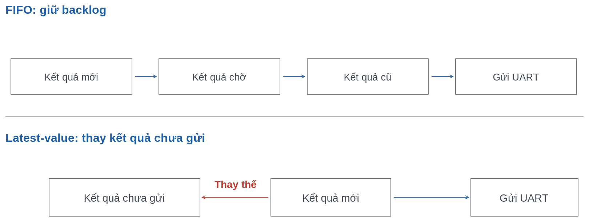

# PHẦN 4. HIỆN THỰC

## 4.1 Pipeline Linux

Nguồn ảnh, suy luận, bridge và bên nhận chạy thành các tiến trình riêng, trao đổi qua IPC Unix datagram. Cách tách này giúp quan sát thời gian chờ ở từng khâu. Suy luận tiền xử lý ảnh rồi gọi MobileNetV2 bằng ONNX Runtime [7]; bridge đóng khung và chuyển kết quả sang UART.

Bridge gửi dữ liệu không chặn, đồng thời duy trì tín hiệu còn hoạt động. Khung đang phát phải hoàn tất trước khi thay kết quả chờ, tránh ghép dữ liệu của hai bản tin.

## 4.2 Cấu hình thực thi

Máy macOS dùng soạn thảo, kiểm tra phần dùng chung và biên dịch chéo firmware. Chương trình Linux chạy trên Pi; firmware FreeRTOS chạy trên STM32.

P0 giữ cách lập lịch mặc định. P1 ưu tiên nguồn ảnh và bridge trên CPU 1, với độ ưu tiên lần lượt 60 và 70; suy luận giữ SCHED_OTHER trên CPU 0. P2 khảo sát giới hạn CPU; P3 chưa có kết quả được chấp nhận.

## 4.3 Firmware

ISR giữ công việc trong ngắt ngắn; dữ liệu đi qua bộ đệm hữu hạn tới tác vụ nhận và khối giám sát. Firmware mặc định nhận bằng DMA vòng, giữ phương án IRQ để đối chiếu. Tác vụ nhận dựng khung và kiểm CRC; dữ liệu mất hoặc gián đoạn không được tính là bằng chứng phía Pi còn hoạt động.

Khối giám sát sở hữu trạng thái đầu ra. Tác vụ gửi trạng thái dùng bản sao đã chụp để việc truyền UART không chặn quyết định giám sát. Bộ nhớ được cấp phát tĩnh nhằm giới hạn tài nguyên trên STM32.

Thời điểm nhận được ghi khi phần mềm đọc xong khung, sau khi byte đã tới UART. Độ trễ đánh thức và việc đọc dồn nhiều byte có thể làm mốc này lệch thời điểm nhận vật lý.

## 4.4 Công cụ và đồng hồ

Cyclictest đo độ trễ đánh thức; stress-ng tạo tải cạnh tranh. Các bản ghi thời gian theo dõi đường xử lý, còn máy phân tích logic đối chiếu UART và GPIO. Trao đổi phản hồi giữa Pi và bộ định thời STM32 giúp quy đổi hai miền đồng hồ [8].

Tuổi nguồn được ước lượng từ tuổi lúc gửi, thời gian sau nhận và phần dự phòng truyền. Ước lượng này chưa được chứng minh là giới hạn lớn nhất.

## 4.5 Bố trí bàn thử và pinout

Bàn thử ở Hình 4.1 dùng UART 3,3 V, TX/RX chéo, mass chung. Camera nối cáp 22-to-15 chân tới CAM/DISP 0. IMU MPU6050 nối I2C1, firmware OS chưa dùng; lấy mẫu thuộc OS-T7.

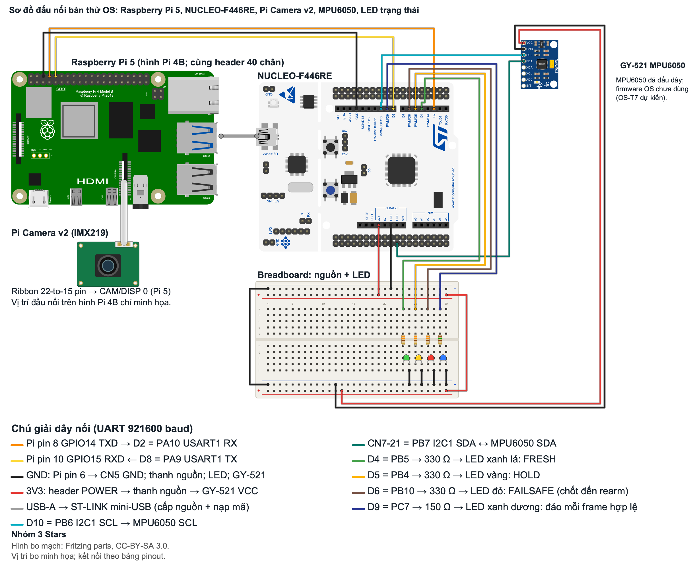

Bảng 2. Pinout kết nối bàn thử OS.
| Phía Pi / ngoại vi | Tín hiệu và vai trò | Chân Nucleo |
|---|---|---|
| Pi 8 / GPIO14 | TXD → USART1 RX, 921600 baud | PA10 / D2 |
| Pi 10 / GPIO15 | RXD ← USART1 TX, 921600 baud | PA9 / D8 |
| 6 | GND chung | GND |
| CAM/DISP 0 | Camera v2 IMX219 qua ribbon 22-to-15 pin | — |
| LED xanh lá | FRESH | D4 / PB5 |
| LED vàng | HOLD | D5 / PB4 |
| LED đỏ | FAILSAFE, chốt đến khi rearm | D6 / PB10 |
| LED xanh dương | Đảo mức mỗi frame được chấp nhận | D9 / PC7 |
| LD2 trên bo | FRESH | PA5 |
| MPU6050 SCL | I2C1, đã nối; OS-T7 dự kiến | PB6 / D10 |
| MPU6050 SDA | I2C1, đã nối; firmware OS chưa dùng | PB7 / CN7 chân 21 |
| MPU6050 VCC/GND | VCC/GND; chưa ghi vị trí chân header nguồn | VCC/GND |

Hình 4.2–4.3 ghi lại bàn thử và camera.

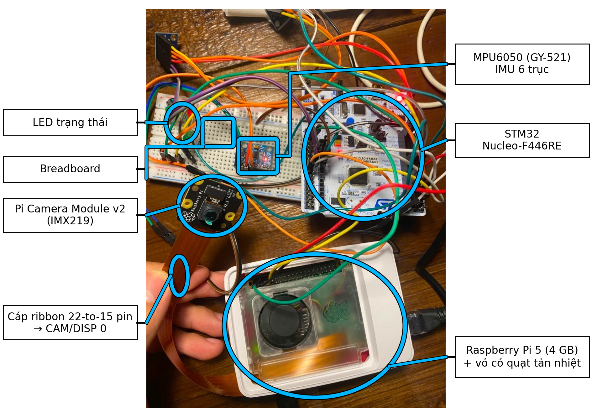 {width=16cm}

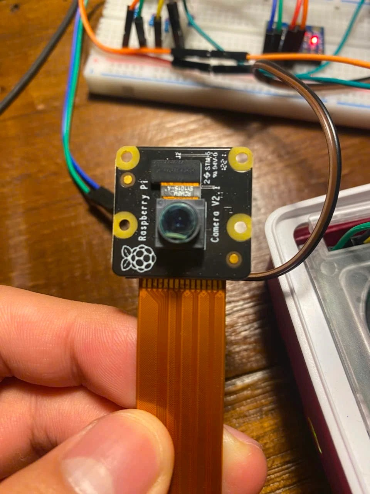 {width=7.5cm}

# PHẦN 5. NGUỒN CAMERA VÀ PIPELINE ƯU TIÊN ĐỘ MỚI

## 5.1 Nguồn ảnh và thời điểm chụp

Nguồn tổng hợp giúp kiểm tra luồng xử lý nhưng không phản ánh thời gian thu ảnh. Pi Camera v2 qua CSI cung cấp ảnh thật để khảo sát lập lịch, IPC và hàng đợi. Mỗi khung ảnh mang thời điểm cảm biến bắt đầu chụp, nên có thể tính dữ liệu đã cũ bao lâu khi tới bên nhận.

Hệ thống cũng ghi thời điểm phần mềm nhận ảnh để phân biệt chậm ở nguồn với chờ xử lý phía sau. Hai mốc cần được quy về cùng đồng hồ trước khi tính tuổi.

## 5.2 Lưu ảnh và chọn đầu vào

Ảnh nằm trong vùng nhớ dùng chung gồm 4 ô để giới hạn bộ nhớ sử dụng. Tiến trình suy luận chỉ nhận thông báo nhỏ rồi đọc ảnh, tránh đưa toàn bộ ảnh vào hàng đợi trao đổi giữa các tiến trình. Trước khi dùng, bên đọc kiểm tra ảnh còn nguyên vẹn và chưa bị ảnh mới ghi đè; dữ liệu không đạt được bỏ đi.

Với FIFO, tiến trình xử lý theo thứ tự thông báo. Với latest-value, nó bỏ thông báo cũ và chọn ảnh hợp lệ mới nhất. Bridge có chính sách tương tự cho kết quả chờ gửi. Cơ chế này loại dữ liệu cũ chứ không làm suy luận nhanh hơn, nên vẫn có thể lỡ hạn khi một lần xử lý kéo dài.

## 5.3 Tính tuổi dữ liệu

Sau mỗi cập nhật, tuổi dữ liệu là khoảng thời gian từ lúc chụp đến lúc bên nhận nhận kết quả. Giữa hai lần cập nhật, tuổi tiếp tục tăng như mô tả ở Phần 2.

Hiện chưa đủ cơ sở diễn giải các phép đo phần mềm thành AoI từ camera tới MCU trên UART vật lý.

# PHẦN 6. ĐÁNH GIÁ SƠ BỘ

## 6.1 Kiểm thử camera

OS-T1 kiểm tra nhịp chụp và mốc thời gian của nguồn ảnh. Nguồn ổn định là điều kiện để phân biệt trễ do camera với trễ do xử lý.

OS-T2 đo thời gian suy luận trên ảnh camera với các số luồng khác nhau. Phép thử chọn cấu hình 2 luồng trước khi thêm tải cạnh tranh.

OS-T3 so sánh P0/P1 khi có tranh chấp bộ nhớ. Nó kiểm tra liệu ưu tiên CPU có đủ giữ thời gian xử lý dưới chu kỳ nguồn hay không.

OS-T4 so sánh FIFO/latest-value ở đầu vào để xem bên nhận có dữ liệu mới hơn không. Bridge giữ kết quả mới nhất.

Bảng 3. Kết quả chính và đối chiếu tiêu chí OS-T1–OS-T4 trên Raspberry Pi 5.
| Kiểm thử | Kết quả | Số đo chính |
|---|---|---|
| OS-T1 — Nhịp chụp và thời gian nguồn | PASS | 30 fps: chu kỳ trung bình 33,3229 ms, biến thiên P99 0,0303 ms, không rơi khung trong 9.000 mẫu. 10 fps: 99,957 ms, P99 0,359 ms, không rơi khung trong 3.000 mẫu. |
| OS-T2 — Suy luận trên ảnh camera | PASS | P50/P99 với 2 luồng: 31,05/39,31 ms; tỷ số 1,27 < 1,5. Mỗi cấu hình có 1.000 lần làm nóng và 5.000 mẫu; chế độ tần số performance. |
| OS-T3 — Tranh chấp bộ nhớ | FAIL — P99 của P1 còn cao hơn P0 ở một số tải; tỷ lệ lỡ hạn vượt 1%. | Trung vị 3 lượt: P99 P0→P1 khi nhàn 59,89→59,61 ms; tải đọc ghi liên tục 355,27→355,42 ms; tải băng thông nhớ 408,25→421,86 ms. Với hạn 100 ms, cả hai cấu hình lỡ hạn 100% ở hai tải nhớ. |
| OS-T4 — Chọn ảnh FIFO/latest-value | FAIL — chưa chứng minh FIFO tồn đọng tăng không giới hạn; còn thiếu tải hỗn hợp và UART có MCU. | AoI trung bình FIFO/latest-value: nhàn 191,8–192,1/92,6–93,4 ms; tải băng thông nhớ 321,3–336,7/223,4–234,6 ms. Tỷ lệ vượt 100 ms: nhàn khoảng 99,8%/0%; tải nhớ 100%/100%. |

OS-T3 mới có 3/5 lượt dự kiến và chưa thu độ trễ đánh thức lớn nhất. OS-T4 có 3 lượt cho mỗi chính sách, dùng PTY trên Pi; chưa đo độ dài hàng đợi. AoI FIFO khi nhàn ổn định khoảng 192 ms, nên chưa đủ bằng chứng về tồn đọng tăng không giới hạn.

Các lượt OS-T2 dùng chế độ ondemand ngày 29/10 không hợp lệ cho đối chiếu này. Hình 6.1–6.4 giữ các phân bố và so sánh chi tiết của Bảng 3.

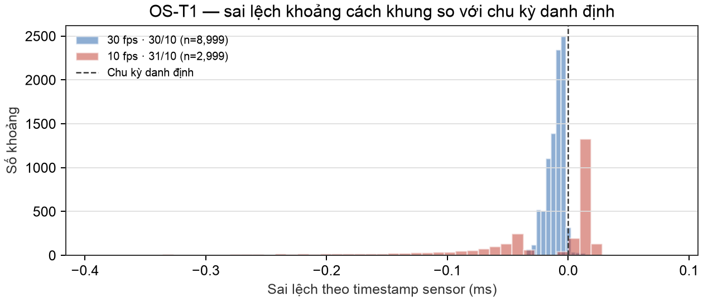
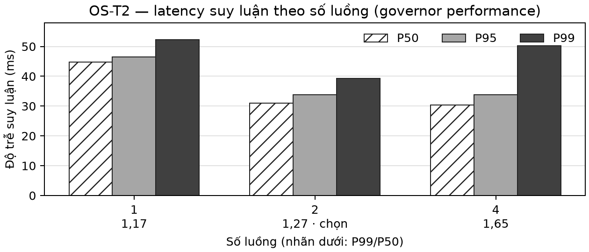
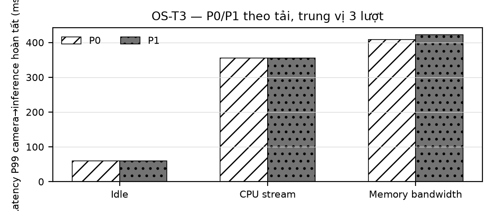
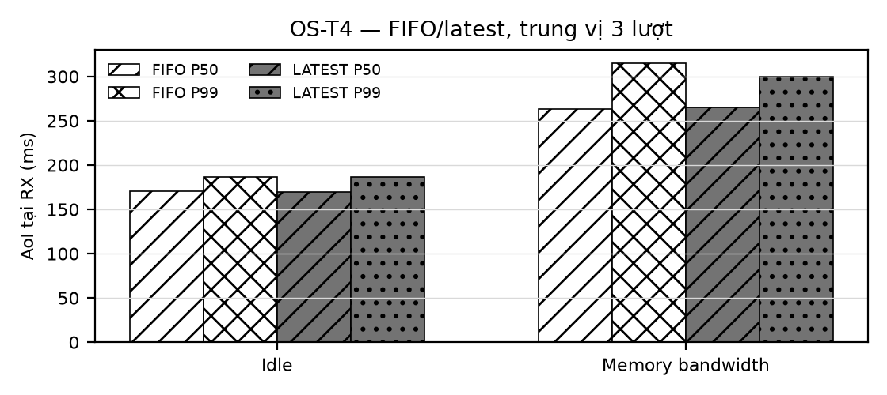

## 6.2 Phạm vi dữ liệu trước camera

Các phép đo cũ dùng nguồn tổng hợp, ảnh cố định hoặc PTY để kiểm tra từng cơ chế trước khi thêm camera.

Bảng 4. Vai trò và giới hạn của các phép đo trước camera.
| Nhóm phép đo | Kết luận sử dụng được |
|---|---|
| Đánh thức tác vụ | Ưu tiên thời gian thực giảm độ trễ đánh thức; chưa suy ra thời gian hoàn thành suy luận. |
| Suy luận độc lập | Thêm luồng chưa bảo đảm độ trễ ổn định khi cạnh tranh CPU. |
| Truyền qua PTY | Bỏ kết quả chờ gửi chưa xử lý được ảnh đang chờ suy luận. |
| UART và giám sát lỗi | Đã ghi nhận chuyển trạng thái; sụt áp và sai lệch đồng hồ hạn chế kết luận đầu-cuối. |

## 6.3 Đánh thức và suy luận

Cyclictest kiểm tra tác vụ được đánh thức trễ bao lâu. Bảng 5 cho thấy ưu tiên thời gian thực giảm P99, nhưng tải nhớ vẫn làm trễ tăng.

Bảng 5. Độ trễ đánh thức P99 trước camera, đơn vị µs.
| Tải | P0 | P1 |
|---|---|---|
| Nhàn rỗi | 57 | 9 |
| Tải băng thông nhớ | 613 | 239 |

Bảng 6 so sánh P99; số lượt hợp lệ giữa các cấu hình khác nhau.

Bảng 6. Thời gian gọi MobileNetV2 P99 trước camera, đơn vị ms.
| Điều kiện | 1 luồng | 4 luồng |
|---|---|---|
| Nhàn rỗi | 48.0 | 70.7 |
| Tải CPU | 53.7 | 100.5 |

## 6.4 Vị trí loại dữ liệu cũ

Bảng 7 đo từ đầu vào tới bên nhận qua PTY, lặp 3 lần mỗi điều kiện. Khi chỉ đặt latest-value ở bridge, tuổi dữ liệu dưới tải nhớ vẫn lớn. Điều này dẫn tới thử bỏ ảnh cũ trước suy luận ở OS-T4.

Bảng 7. AoI trung bình trước camera khi đổi chính sách tại bridge, đơn vị ms.
| Tải | FIFO | Latest-value |
|---|---|---|
| Nhàn rỗi | 94.69 | 94.59 |
| Tải băng thông nhớ | 6660 | 6958 |

## 6.5 UART và phản ứng khi lỗi

Các lượt UART cũ có sụt áp, sai lệch đồng hồ hoặc thiếu bản ghi, nên chỉ dùng chẩn đoán. Bảng 8 giữ phản ứng khi chủ động dừng bridge hoặc suy luận để kiểm tra hai đường giám sát riêng. Mỗi tình huống có 5/5 lượt được chấp nhận trong cửa sổ quan sát ngắn.

Bảng 8. Thời gian MCU chuyển FAILSAFE, đơn vị ms.
| Tình huống | Tính từ | P50 | Lớn nhất |
|---|---|---|---|
| Kết thúc bridge | Tín hiệu còn hoạt động cuối | 100.456 | 100.641 |
| Tạm dừng bridge | Tín hiệu còn hoạt động cuối | 100.577 | 100.596 |
| Tạm dừng suy luận | Kết quả cuối | 475.754 | 475.815 |
| Ngừng suy luận, bridge vẫn báo hoạt động | Kết quả cuối | 475.596 | 475.917 |

Ngưỡng mất hoạt động là 100 ms; ngưỡng HOLD/FAILSAFE theo tuổi là 200/500 ms. Hai loại lỗi dùng mốc tham chiếu khác nhau nên không gộp độ trễ. Tuổi lúc gửi và dự phòng truyền 5 ms giải thích vì sao khoảng sau nhận có thể dưới 500 ms; các số đo này chưa xác lập giới hạn phản ứng lớn nhất.

# PHẦN 7. THẢO LUẬN VÀ HẠN CHẾ

## 7.1 Diễn giải theo câu hỏi

Tải bộ nhớ làm tăng mạnh thời gian xử lý, trong khi ưu tiên CPU chưa cô lập được tài nguyên dùng chung. Cần thử riêng từng thay đổi về độ ưu tiên, gắn lõi và giữ trang nhớ để biết yếu tố nào có tác dụng.

Bỏ ảnh cũ trước suy luận làm giảm tuổi dữ liệu ở bên nhận; bỏ kết quả tại bridge chỉ tác động tới phần chờ truyền. Tuy nhiên, khi bản thân suy luận quá chậm, latest-value vẫn không giữ được dữ liệu dưới ngưỡng tuổi.

Các phép thử lỗi ghi nhận STM32 chuyển trạng thái khi bridge hoặc suy luận dừng. Chúng chưa xác lập thời gian phản ứng lớn nhất trong mọi tình huống.

## 7.2 Độ tin cậy

Sụt áp, khác biệt chế độ điều chỉnh tần số và số luồng hạn chế khả năng so sánh các lượt cũ. Một số lượt thiếu bằng chứng tải hoạt động liên tục hoặc thiếu theo dõi toàn thời gian. Đo điện áp định kỳ có thể bỏ lỡ nhiễu ngắn; nhiều mẫu trong một lượt không thay thế được các lần chạy độc lập.

Đối chiếu đồng hồ phụ thuộc trao đổi phản hồi và độ mới của phép khớp. Khi tiêm lỗi, công việc ưu tiên cao có thể khiến bridge thiếu CPU và làm gián đoạn ghi nhận trạng thái. Thiếu bản ghi không chứng minh MCU luôn ở FRESH, nên nhóm không tự điền tỷ lệ thời gian cho khoảng thiếu.

Bằng chứng hiện có chưa xác nhận an toàn robot, mức dùng ngăn xếp dài hạn hoặc khả năng nhận DMA khi tải kéo dài. Với robot thật, tắt động cơ có thể gây mất cân bằng và cần chính sách riêng.

# PHẦN 8. KẾ HOẠCH TIẾP THEO

## 8.1 Lịch dự kiến đến hết tháng 11/2026

Nhóm lưu cấu hình và dữ liệu gốc để có thể lặp lại phép đo, không đổi ngưỡng sau khi xem kết quả. Mốc hoàn tất dự kiến là 30/11/2026.

Bảng 9. Kế hoạch kiểm thử và hoàn thiện cuối kỳ.
| Thời gian năm 2026 | Công việc và điều kiện hoàn thành |
|---|---|
| 01–07/11 | Củng cố OS-T1/T2; bổ sung lượt và độ trễ đánh thức lớn nhất cho OS-T3; đo độ dài hàng đợi, thêm tải hỗn hợp cho OS-T4. |
| 08–12/11 | OS-T5: UART 921600 baud; 10.000 khung hợp lệ, chèn khung lỗi; không nhận khung lỗi, RTT P99 < 5 ms. |
| 13–18/11 | OS-T6: dừng bridge, suy luận hoặc gây chiếm CPU; 10 lần mỗi lỗi; kiểm LED, chốt lỗi và tái kích hoạt; chạy bình thường 30 phút. |
| 19–23/11 | OS-T7 sau OS-T5/T6: lấy mẫu MPU6050 200 Hz khi UART rảnh và dồn khung; biến thiên P99 < 100 µs, không lỡ mẫu. |
| 24–26/11 | OS-T8: rà soát kịch bản mở rộng trong phạm vi UART. |
| 27–30/11 | Bổ sung phép đo thiếu; tổng hợp kết quả và bất định; hoàn thiện báo cáo, slide, trình diễn camera → suy luận → UART → LED. |

## 8.2 Điều kiện phép đo và bàn thử

Mặc định đo ba lượt, mỗi lượt năm phút, hướng tới năm lượt hợp lệ trừ kịch bản riêng. Cần giữ chế độ tần số performance, xác nhận không bị giới hạn do nguồn hoặc nhiệt và theo dõi tải suốt lượt. Hồ sơ phép đo phân biệt Pi 4 GB hiện tại với Pi 8 GB trong dữ liệu cũ.

OS-T2 giữ 1.000 lần làm nóng và 5.000 mẫu mỗi số luồng. Khi đổi firmware, cần sao lưu, kiểm tra bản nạp và đọc lại theo hướng dẫn thao tác.

# PHẦN 9. KẾT LUẬN

Nền tảng dùng tải suy luận trên Linux và giám sát FreeRTOS qua UART để khảo sát độ trễ và tuổi dữ liệu. OS-T1/OS-T2 PASS; OS-T3/OS-T4 còn FAIL theo Bảng 3. Kết quả cho thấy giới hạn của ưu tiên CPU và vai trò của việc bỏ ảnh cũ trước suy luận. Khối giám sát cần kiểm cả tình trạng hoạt động lẫn độ mới. Nhóm sẽ bổ sung số lượt, độ dài hàng đợi và phép đo UART có MCU trước khi mở rộng kết luận.

# TÀI LIỆU THAM KHẢO
[1] Linux kernel documentation, “Real-Time group scheduling.” Truy cập ngày 10/10/2026.
[2] H. Yun, G. Yao, R. Pellizzoni, M. Caccamo, and L. Sha, “MemGuard: Memory bandwidth reservation system for efficient performance isolation in multi-core platforms,” in *IEEE RTAS*, 2013, pp. 55–64.
[3] S. K. Kaul, R. D. Yates, and M. Gruteser, “Real-time status: How often should one update?” in *IEEE INFOCOM*, 2012, pp. 2731–2735.
[4] S. K. Kaul, R. D. Yates, and M. Gruteser, “Status updates through queues,” in *CISS*, 2012, pp. 1–6.
[5] S. Bak, D. K. Chivukula, O. Adekunle, M. Sun, M. Caccamo, and L. Sha, “The System-Level Simplex Architecture for Improved Real-Time Embedded System Safety,” in *IEEE RTAS*, 2009, pp. 99–107.
[6] S. Bak, T. T. Johnson, M. Caccamo, and L. Sha, “Real-Time Reachability for Verified Simplex Design,” in *RTSS*, 2014, pp. 138–148.
[7] ONNX Runtime documentation, “Thread management.”
[8] D. Mills, “Simple Network Time Protocol (SNTP) Version 4,” RFC 4330, Jan. 2006, sec. 5.

