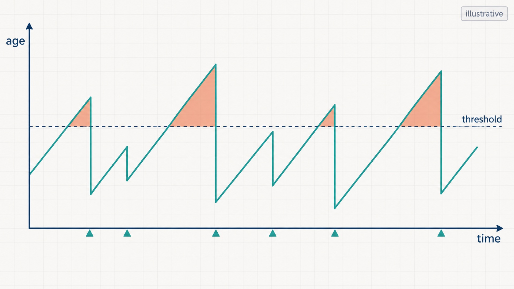
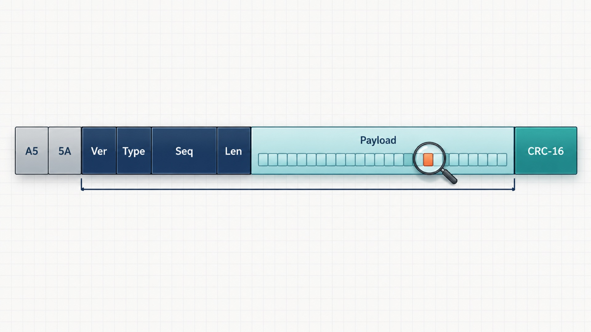
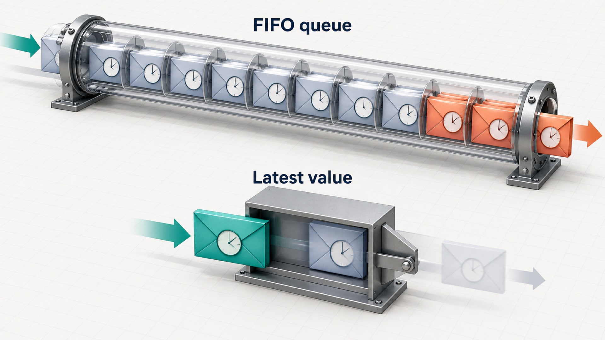

<!-- COVER -->
**Trường: Đại học Bách khoa Hà Nội (HUST); Học phần: Hệ điều hành**

**Đề tài: NỀN TẢNG THỰC THI EDGE-AI KHÔNG ĐỒNG NHẤT (Heterogeneous Edge-AI Runtime)**

Nhóm thực hiện: 3 Stars

Nguyễn Quốc Khánh – 20233464 (Nhóm trưởng)

Nguyễn Trung Hiếu – 20233398

Nguyễn Quang Vinh – 20233718

Giảng viên hướng dẫn: TS. Nguyễn Quang Minh

Mã lớp bài tập: 173876

Hà Nội, tháng 10/2026
<!-- PAGE -->
<!-- ABSTRACT -->
Báo cáo trình bày nền tảng thực thi Edge-AI không đồng nhất đang trong quá trình triển khai cho học phần Hệ điều hành. Raspberry Pi chạy Ubuntu xử lý suy luận; STM32 chạy FreeRTOS giám sát độc lập qua UART. Nghiên cứu tập trung vào lập lịch, tranh chấp tài nguyên, truyền thông và độ tươi dữ liệu. Bốn câu hỏi nghiên cứu xem xét ảnh hưởng của tải, cấu hình thực thi, thay thế dữ liệu chờ và phản ứng khi Linux gặp lỗi. Kết quả sơ bộ cho thấy ưu tiên thời gian thực cải thiện đuôi trễ đánh thức nhưng không loại bỏ tranh chấp bộ nhớ. Thay thế kết quả tại bridge không xử lý được tồn đọng trước suy luận. Quan sát phần cứng hỗ trợ phân biệt mất heartbeat với kết quả cũ dù heartbeat còn hoạt động. Tuy nhiên, nhiều lượt đo bị gắn cờ do điện áp thấp; bằng chứng phần mềm và phần cứng có phạm vi khác nhau. Báo cáo giữ nguyên các loại trừ, phân biệt số đã đo với số đã tính và cấu hình dự kiến. Các quan sát chưa chứng minh giới hạn thời gian xấu nhất hoặc an toàn cơ cấu chấp hành. Lộ trình tiếp theo ưu tiên nguồn điện, phép đo lặp và đối chiếu thời gian độc lập.

**Từ khóa:** hệ điều hành; Linux; FreeRTOS; UART; lập lịch; độ tươi dữ liệu; giám sát độc lập.

**Quy ước bằng chứng.** “Đã đo” là quan sát được lưu trong dữ liệu; “đã tính” là phép tính từ cấu hình hoặc dữ liệu đã đo; “dự kiến” là thiết kế, giả thuyết hay tham số chưa hiệu chuẩn; “chưa biết” là thiếu bằng chứng. FLAGGED là có cờ cần giải thích; INVALID là lượt đo bị loại trong phạm vi đánh giá tương ứng. Mọi kết quả thực nghiệm trong báo cáo đều là **kết quả sơ bộ**, kể cả khi được chấp nhận theo quy tắc tại thời điểm thu thập.

<!-- PAGE -->
<!-- TOC -->
<!-- PAGE -->
# 1 Giới thiệu
## 1.1 Động lực và bài toán
Hệ thống Edge-AI thường kết hợp tính toán biến thiên với phản ứng cần đúng hạn. Một kết quả suy luận chính xác vẫn có thể mất giá trị khi đến quá muộn. Linux thuận tiện cho mô hình và thư viện, nhưng một tiến trình có thể phải chờ CPU, bộ nhớ hoặc hàng đợi. Do đó, thông lượng cao không đủ để kết luận rằng đầu ra luôn phù hợp với trạng thái hiện tại. Đồ án dùng sự khác biệt này để quan sát cơ chế hệ điều hành trên nền tảng không đồng nhất.

Theo tài liệu thiết kế của nhóm, Raspberry Pi 5 chạy Ubuntu Server 24.04 ARM64 đảm nhận tác vụ tính toán; STM32F446RE chạy FreeRTOS nhận dữ liệu và quyết định đầu ra mô phỏng. Liên kết giữa hai miền là UART. AI chỉ tạo tải thực tế cho nghiên cứu lập lịch, tranh chấp tài nguyên và truyền thông. Đề tài không đề xuất mạng nơ-ron mới và không đưa suy luận xuống MCU.
## 1.2 Câu hỏi nghiên cứu và đóng góp
- RQ1: Tải cạnh tranh làm thay đổi thời gian phục vụ và chuyển giao dữ liệu như thế nào?
- RQ2: Điều chỉnh ưu tiên, gán CPU và khóa bộ nhớ khôi phục được phần nào của độ trễ?
- RQ3: FIFO và latest-value tác động thế nào đến độ tươi; nên thay thế dữ liệu ở đâu?
- RQ4: Khi Pi ngừng cung cấp dịch vụ, MCU phát hiện và chuyển đầu ra về trạng thái an toàn mô phỏng khi nào?

Đóng góp ở mức học phần gồm thiết kế tách quyền điều khiển, đường ống có dấu thời gian, bộ giám sát phân biệt sống còn với độ tươi, và tập bằng chứng giữ lại cả lượt đo thất bại. Kết quả sơ bộ giúp phát hiện hàng đợi sai vị trí và nhầm lẫn mốc thời gian. 

# 2 Cơ sở lý thuyết và các công trình liên quan
## 2.1 Lập lịch Linux và tranh chấp tài nguyên
CFS phân phối thời gian xử lý theo trọng số và lịch sử sử dụng CPU. EEVDF tiếp tục mục tiêu công bằng bằng điều kiện đủ tư cách và thời hạn ảo. Các khái niệm này mô tả lớp lập lịch thông thường; chúng không biến một tác vụ thành công việc có thời hạn cứng. Khi diễn giải phép đo, cần ghi phiên bản kernel và chính sách thực tế của luồng.

SCHED_FIFO dùng ưu tiên thời gian thực cố định: luồng sẵn sàng có ưu tiên cao có thể chiếm CPU của công việc thấp hơn. Nó hữu ích cho bridge nhỏ cần được đánh thức kịp thời, nhưng luồng chạy lâu có thể làm đói công việc khác. Giới hạn băng thông tác vụ thời gian thực và cấu hình nhóm phải được xem cùng quyền đặt ưu tiên [1].

Gán CPU giảm di chuyển và tạo cấu hình thí nghiệm rõ hơn. Tuy nhiên, các lõi vẫn dùng chung những tài nguyên của hệ thống nhớ. Một luồng có CPU riêng vẫn có thể chịu độ trễ khi tải khác tạo lưu lượng bộ nhớ. MemGuard nghiên cứu cô lập băng thông bộ nhớ [2]; đồ án chỉ dùng công trình này để giải thích động lực, không cài cơ chế kernel tương ứng.

cgroups cho phép nhóm tiến trình và giới hạn tài nguyên. Hạn mức CPU có thể khống chế tải nền nhưng cũng gây throttling nếu đặt sai. mlockall giữ trang trong RAM để giảm rủi ro lỗi trang trong đường thời gian nhạy cảm; nó không xóa thời gian tính toán, cache miss hay tranh chấp nhớ. Cần kiểm tra lỗi trả về và ghi trạng thái khóa bộ nhớ, thay vì chỉ ghi ý định cấu hình.
## 2.2 PREEMPT_RT và giới hạn suy diễn
PREEMPT_RT nhằm giảm những vùng không thể bị chiếm quyền và thay đổi cách xử lý một phần công việc kernel. Trong phạm vi đồ án, kernel Real-time Ubuntu đóng gói chỉ là hồ sơ P3 dự kiến; không sửa hoặc tự biên dịch kernel. Kết quả sơ bộ hiện có trên kernel stock không phải so sánh PREEMPT_RT. Mọi khẳng định về lợi ích của P3 vẫn là chưa biết cho hệ thống này.

## 2.3 Age of Information và dữ liệu còn giá trị
Age of Information (AoI) tại thời điểm quan sát là thời gian đã trôi qua kể từ lúc sinh dữ liệu mới nhất có ích mà bên nhận đang giữ [3], [4]. Độ trễ một gói chỉ mô tả hành trình gói ấy; AoI còn tăng trong khoảng không có gói mới. Vì vậy, trung vị độ trễ chuyển giao không thể thay thế trung bình AoI. Nếu chỉ chọn những gói giao thành công, ta còn bỏ sót khoảng mất dữ liệu và phần đuôi sau lần cập nhật cuối.

Hình 1 minh họa sự tăng tuổi theo thời gian và việc tuổi giảm khi có cập nhật mới. Khi gói tới, tuổi thường giảm xuống tuổi đã tích lũy trên đường đi, không mặc nhiên về không. Muốn tính trung bình AoI phải tích phân trên cửa sổ quan sát đã xác định, nêu cách xử lý trước cập nhật đầu tiên và giữ lại các khoảng ngừng chuyển giao.

## 2.4 Simplex và FreeRTOS trên MCU
Simplex tách khối phức tạp khỏi bộ điều khiển hoặc giám sát đáng tin cậy, với cơ chế quyết định quyền tác động [5], [6]. Đồ án vận dụng ý tưởng ranh giới quyền điều khiển: Pi đưa đề xuất; MCU quyết định đầu ra mô phỏng. Timeout và trạng thái FAILSAFE không đủ cấu thành chứng minh Simplex hình thức. Mô hình đối tượng, miền an toàn, giả thiết lỗi và bằng chứng thời gian vẫn cần phân tích riêng.

FreeRTOS cung cấp lập lịch ưu tiên có chiếm quyền và các cơ chế bàn giao hữu hạn. Trên MCU, mục tiêu là đường xử lý dễ quan sát: ngắt nhận dữ liệu, tác vụ phân tích, tác vụ giám sát và đầu ra. Tác vụ ưu tiên cao vẫn có thể trễ vì đoạn che ngắt hoặc công việc dài hơn dự kiến. Cấp phát tĩnh và một chủ sở hữu trạng thái giúp giảm biến thiên, nhưng không thay cho phép đo stack, thời gian thực thi và hành vi khi bộ đệm đầy.

# 3 Thiết kế hệ thống
## 3.1 Kiến trúc và ranh giới quyền điều khiển
Đường dữ liệu gồm source → suy luận → bridge trên Pi, UART, RX → supervisor → GPIO trên STM32. Logger nhận dấu thời gian và trạng thái để tái dựng hành trình. Tải nền chạy trong miền Linux để tạo tranh chấp có kiểm soát. MCU không phụ thuộc vào tiến trình logger để tiếp tục kiểm tra hạn; ngược lại, log thiếu có thể khiến người phân tích không đủ bằng chứng kết luận về một lần chạy.

Quyền ghi đầu ra thuộc supervisor. Kết quả suy luận hợp lệ chỉ là điều kiện đầu vào, không phải lệnh ghi trực tiếp GPIO. Heartbeat trả lời câu hỏi bridge còn gửi được dữ liệu hay không; INFERENCE trả lời có kết quả đủ mới hay không. Không dùng heartbeat để làm mới tuổi của kết quả cũ. Đầu ra trong đồ án là chỉ thị GPIO, chưa có cơ cấu chấp hành vật lý hoặc watchdog phần cứng độc lập.
## 3.2 Khung UART và loại bản tin
Hình 2 thể hiện khung chung. Bảng 1 nêu hợp đồng đang được tài liệu giao thức mô tả; số byte là cấu hình, không phải số đo. Parser kiểm tra độ dài và CRC trước khi giao bản tin cho logic chính sách. Số thứ tự hỗ trợ nhận diện dữ liệu cũ, trùng và khoảng mất; CRC kiểm tra toàn vẹn truyền, không chứng minh tính đúng đắn của nội dung suy luận.

Bảng 1. Cấu trúc khung theo tài liệu giao thức; dự kiến/cấu hình.
| Trường | Kích thước và vai trò |
|---|---|
| SOF | 2 byte: A5 5A, đồng bộ khung |
| version, type | Mỗi trường 1 byte; phân biệt phiên bản và bản tin |
| seq, len | 2 byte thứ tự; 1 byte độ dài payload |
| payload | Tối đa 64 byte, các trường nhiều byte little-endian |
| CRC | 2 byte CRC-16/CCITT-FALSE; phủ version đến payload |

HEARTBEAT mang thông tin sống còn và định danh phiên. INFERENCE mang kết quả, thứ tự đầu vào và tuổi tại lúc gửi. ECHO_REQ/ECHO_RESP phục vụ ước lượng quan hệ đồng hồ; MCU_STATUS báo trạng thái và bộ đếm. STATE_EVENT ghi chuyển trạng thái, INF_RX ghi thời điểm nhận suy luận. Đây là hợp đồng có phiên bản; không giả định hình minh họa cũ chứa đầy đủ phần mở rộng hiện tại.

## 3.3 Máy trạng thái và phiên làm việc
Máy trạng thái gồm INIT, RUN, HOLD và FAILSAFE. Trong mã và log, trạng thái hoạt động RUN được đặt tên **FRESH**; báo cáo dùng RUN/FRESH để tránh đổi nghĩa dữ liệu. INIT giữ đầu ra an toàn mô phỏng khi chưa đủ điều kiện. RUN/FRESH cần cả liveness và kết quả hợp lệ. HOLD khóa đầu ra cần dữ liệu mới khi tuổi vượt ngưỡng. FAILSAFE được chốt; lưu lượng tốt trở lại không tự động xóa chốt.

Phiên bridge mới không được kế thừa lịch sử của phiên cũ. Định danh session phân biệt lần khởi động; generation là dấu nội bộ gắn với dữ liệu trong hàng đợi. Khi đổi phiên hoặc tái kích hoạt, dữ liệu từ generation cũ bị loại. Kiểm tra hết hạn phải diễn ra trước xử lý dữ liệu vừa tới để một bản tin đúng sát thời hạn không che mất sự kiện timeout. Bản firmware hiện tại không cung cấp tự động rearm từ xa; không mô tả khả năng của lõi portable thành chức năng đã hoàn tất trên bo mạch.
## 3.4 FIFO và latest-value
FIFO giữ thứ tự nhưng có thể tích lũy tuổi khi tốc độ phục vụ thấp hơn nguồn. Latest-value thay dữ liệu đang chờ bằng dữ liệu mới nhất, phù hợp với nhiệm vụ quan tâm trạng thái hiện tại. Hình 3 chỉ minh họa chính sách lưu trữ. Nó không nói rằng suy luận đang chạy bị hủy; thay phần tử chờ khác với chiếm quyền công việc đang phục vụ [4].

Đặt latest-value tại bridge chỉ tác động phần đã suy luận xong. Nếu tồn đọng ở đầu vào, một kết quả vừa hoàn tất vẫn có thể bắt nguồn từ dữ liệu cũ. Chính sách trước suy luận rút các datagram sẵn có, giữ đầu vào hợp lệ mới nhất và ghi số bị bỏ. Đổi chính sách phải giữ cùng tải, nguồn và hồ sơ lập lịch khi đánh giá. 

# 4 Hiện thực
## 4.1 Đường ống Linux và tải suy luận
Hiện thực tách source, inference, bridge và receiver thành tiến trình, dùng IPC Unix datagram. Source đánh dấu đầu vào; inference nhận dữ liệu, tiền xử lý và gọi ONNX Runtime với MobileNetV2. Kết quả đi sang bridge để đóng khung UART. Có tải tổng hợp thay thế nhằm kiểm tra logic trên host mà không cần runtime hoặc mô hình thật. Sự tách tiến trình làm rõ ranh giới chờ đầu vào, phục vụ tính toán và chờ chuyển giao.

Phiên đo nền dùng mobilenetv2-12.onnx và ONNX Runtime 1.31.0 theo hồ sơ đo nền.  Cần giữ cùng mô hình, đầu vào, số luồng và thiết lập runtime khi so sánh. Tăng số luồng có thể tận dụng CPU lúc nhàn nhưng cũng cạnh tranh với stressor; tổng thời gian phục vụ không được đồng nhất với thời gian bên trong lời gọi suy luận [7].

Bridge sử dụng xuất nối tiếp không chặn, chọn FIFO hoặc latest-value, phát heartbeat và trao đổi echo. Khi ghi một phần khung, cần hoàn tất ranh giới khung đang phát trước khi thay dữ liệu chờ; thay tùy tiện giữa khung sẽ phá giao thức. Logger ghi các dấu thời gian và bộ đếm để nối đầu vào với kết quả. Nếu phần ghi log bị trì hoãn, phải phân biệt thời điểm sự kiện với lúc dòng CSV được ghi ra đĩa.
## 4.2 Hồ sơ và môi trường thực thi
Host macOS phục vụ biên soạn, kiểm tra portable và biên dịch chéo. Pi mới là nơi thực thi ứng dụng Linux và tạo tải; STM32 chạy firmware FreeRTOS. Không dùng khả năng chạy test trên Mac làm bằng chứng cho thời gian đánh thức hoặc UART vật lý trên Pi.

Trong chiến dịch phần mềm, P1 thực tế đặt source FIFO ưu tiên 60 và bridge FIFO ưu tiên 70 trên CPU 1; suy luận vẫn SCHED_OTHER trên CPU 0. Đây là cấu hình đã ghi trong hồ sơ cấu hình áp dụng, khác kế hoạch bridge ưu tiên 50 trong hướng dẫn cũ.  P2 quota và P3 kernel thời gian thực chưa có kết quả sơ bộ so sánh được chấp nhận trong tập tài liệu này.

## 4.3 Firmware: từ nhận byte đến quyết định
Thiết kế ban đầu dùng ISR → bộ đệm hữu hạn → RX task → supervisor → output. Mục đích là tách tiếp nhận byte khỏi quyết định chính sách, không phân tích toàn bộ khung hoặc điều khiển đầu ra ngay trong ngắt. Hiện thực firmware mặc định đã chuyển sang nhận DMA vòng; chế độ IRQ vẫn được giữ để đối chiếu. Báo cáo giữ mô hình bàn giao ban đầu nhưng không mô tả stream buffer như mặc định hiện tại.

RX task lấy dữ liệu, dựng khung, kiểm CRC rồi chuyển sự kiện có dấu thời gian và generation cho supervisor. Bộ đệm đầy phải tạo bộ đếm mất hoặc dấu gián đoạn, không âm thầm làm mới liveness. Supervisor là chủ sở hữu duy nhất của trạng thái. Tác vụ trạng thái truyền các bản ghi đã chụp, tránh để UART TX chặn đường quyết định. Cấp phát tĩnh giảm phụ thuộc vào heap và giúp kiểm tra giới hạn tài nguyên.

Với DMA, thời điểm nhận trong log là lúc RX đọc byte CRC cuối, muộn hơn cạnh vật lý tại chân UART. Chu kỳ đánh thức, jitter lập lịch và thời gian rút cả lô đều góp vào chênh lệch. Không được đổi tên dấu thời gian này thành thời điểm đến phần cứng. Trường hợp bỏ lỡ cả vòng DMA hoặc lỗi UART phải được xử lý bảo thủ. Kiểm thử con trỏ vòng trên host không mô phỏng đầy đủ tranh chấp bus và hoạt động ngoại vi thật.
## 4.4 Công cụ đo và miền đồng hồ
cyclictest quan sát đánh thức timer; stress-ng tạo tải; CSV pipeline quan sát hành trình kết quả; echo hỗ trợ ước lượng ánh xạ đồng hồ; logic analyzer quan sát UART và GPIO. Mỗi công cụ có điểm quan sát khác nhau. Dấu thời gian Pi và TIM2 thuộc hai miền riêng: chỉ trừ trực tiếp khi cùng đồng hồ, hoặc sau ánh xạ đã nêu bất định [8].

Tuổi nguồn ước lượng bằng tuổi lúc gửi cộng thời gian từ nhận đến hiện tại trên MCU và khoản dự phòng truyền. Khoản dự phòng là giả thiết cấu hình, chưa phải cận trên đã chứng minh. Tài liệu cũ còn khác nhau giữa MONOTONIC và MONOTONIC_RAW; khi tái lập phải kiểm tra clock thực tế của producer và monitor, không trộn hai loại vì tên đều là monotonic. Độ dư khớp echo nhỏ cũng không tự chứng minh đường truyền đối xứng hoặc độ chính xác tuyệt đối.

# 5 Đánh giá sơ bộ
## 5.1 Phương pháp, môi trường và quy tắc hợp lệ
**KẾT QUẢ SƠ BỘ.** Bảng 2 tổng hợp phạm vi bằng chứng. Thí nghiệm phải giữ đầu vào, tải, cấu hình, governor, trạng thái nhiệt và công suất; thay một nhóm cơ chế cần được công bố rõ. Số mẫu trong run không phải số lần lặp độc lập. Các phân vị trong bảng nguồn thường là trung vị của phân vị từng run, còn max là cực đại quan sát; không ghép chúng thành một phân phối chung.

Bảng 2. Kết quả sơ bộ: kiểm kê lượt đo theo hồ sơ dữ liệu; số đã tính từ hồ sơ lưu trữ.
| Tập bằng chứng | Số lượt và phạm vi chấp nhận |
|---|---|
| cyclictest | v1: 30/30; v2: 3/15 mỗi hồ sơ, chỉ idle |
| Inference baseline | 21/24; loại 3 lượt 4 luồng vì điện áp thấp trực tiếp |
| E1/E2/E3 PTY | v1: 45/45 phần mềm; v2: 0/45 đủ bằng chứng bổ sung |
| E3b đầu vào latest | 3/12; cả 6 lượt có tải đều INVALID |
| E3 UART ban đầu | 0/18; cờ nguồn, clock và thiếu sự kiện có thể chồng nhau |
| E4 gốc | 17/25 mục; gồm 5 mục F5 chưa thực hiện |
| F5 riêng | 5/5 cho chuyển trạng thái cửa sổ ngắn |

Nguồn: các thư mục 2026-10-11_cyclictest, 2026-10-11_inference_baseline, 2026-10-11_e1_e2_e3_pty, 2026-10-12_e3b_input_latest, 2026-10-12_e3_real_uart, 2026-10-12_e4_faults và 2026-10-12_f5_stale.

Kernel được ghi là 6.8.0-1064-raspi, PREEMPT_DYNAMIC. Nguồn Pi là 5 V / 3 A; baseline suy luận ghi điện áp dưới tải 4.66–4.92 V. Những con số này là metadata đã đo, không phải thông số thiết kế mới. Baseline dùng governor ondemand, còn chiến dịch pipeline dùng performance, nên không so trực tiếp hai tập như một thử nghiệm chỉ thay IPC.

Quy tắc v2 yêu cầu monitor có timestamp RAW phủ cửa sổ, khoảng cách mẫu không quá 1.5 s, chứng minh stressor còn sống và clock fit không cũ quá 5 s. Replay không xác nhận được một số run cũ vì thiếu bằng chứng bổ sung; điều đó không chứng minh chúng có lỗi vật lý. Giữ nhãn đã đo theo v1, công bố hạn chế v2 và áp dụng v2 cho lần chạy mới. Đồng hồ lịch Pi lệch khoảng 3 ngày giải thích tên run, không sửa lại các khoảng thời gian monotonic.

## 5.2 Đánh thức timer và suy luận độc lập
**KẾT QUẢ SƠ BỘ — đã đo theo v1.** Bảng 3 dùng cyclictest với luồng đo trên CPU 0, khoảng timer 1 ms, khóa bộ nhớ, mỗi run 120 s và 3 lần lặp mỗi điều kiện. P0 là SCHED_OTHER; P1 là FIFO ưu tiên 50 đã kiểm tra trên luồng đo. Bảng chỉ trích idle và memrate để làm rõ đuôi trễ; các tải khác vẫn được giữ trong nguồn.

Bảng 3. Kết quả sơ bộ cyclictest, đơn vị µs; P50/P99 là trung vị giữa run, max là cực đại quan sát.
| Tải | P0 P50 | P0 P99 | P0 max | P1 P50 | P1 P99 | P1 max |
|---|---|---|---|---|---|---|
| idle | 53 | 57 | 2659 | 3 | 9 | 92 |
| memrate CPU 2–3 | 55 | 613 | 5170 | 5 | 239 | 1094 |

Nguồn: results/2026-10-11_cyclictest/SUMMARY.md; run 20261008T091937Z_cyc_P0/ và 20261008T091937Z_cyc_P1/. Giới hạn v2: chỉ idle còn đủ bằng chứng, tải thiếu xác nhận stressor sống.

Trung vị P0 còn chịu timer slack nên không gán toàn bộ khoảng cách P50 cho chờ bộ lập lịch. P1 cải thiện đuôi đánh thức nhưng P99 dưới memrate vẫn cao hơn idle. Đây là quan sát phù hợp với vấn đề tài nguyên chung, chưa phải phép đo trực tiếp băng thông nhớ. Timer wake-up không phải thời gian suy luận hoặc độ trễ UART.

Bảng 4. Kết quả sơ bộ thời gian gọi MobileNetV2, ms; đã đo, chỉ dùng run được baseline chấp nhận.
| Tải / luồng ORT | Lặp hợp lệ | P50 | P99 | Max |
|---|---|---|---|---|
| idle / 1 | 3 | 44.0 | 48.0 | 57.0 |
| idle / 3 | 3 | 29.4 | 38.5 | 52.8 |
| idle / 4 | 1 | 31.4 | 70.7 | 94.1 |
| cpu / 1 | 3 | 45.1 | 53.7 | 65.5 |
| cpu / 4 | 2 | 60.3 | 100.5 | 150.3 |

Nguồn: results/2026-10-11_inference_baseline/SUMMARY.md; idle_r*/threads-N/ và cpu23_r*/threads-N/. Mỗi run có 1000 lần gọi được tính giờ sau 50 lần warm-up.

Bảng 4 cho thấy thêm luồng không bảo đảm tốt hơn khi có tải. Các ô có số lặp khác nhau vì loại nguồn điện, nên không được chọn cực trị thuận lợi rồi kết luận cấu hình tối ưu. Tiền xử lý được ghi riêng trong nguồn; số ở đây không đại diện toàn bộ thời gian từ sinh đầu vào đến đầu ra MCU.
## 5.3 Tranh chấp, điều chỉnh và chính sách hàng đợi
**KẾT QUẢ SƠ BỘ — đã đo phần mềm/PTY theo v1.** Bảng 5 trả lời một phần RQ1–RQ3. Delivery tính từ đầu vào đến receiver trên Pi, không đến chân STM32. Mỗi ô có 3 lần lặp. V2 không xác nhận được độ phủ monitor của cả chiến dịch; các số vẫn là quan sát lưu trữ có giới hạn đó.

Bảng 5. Kết quả sơ bộ E1/E2/E3: độ trễ và AoI, đơn vị ms; không phải phép đo UART vật lý.
| Phép đo / điều kiện | P50 delivery hoặc mean AoI | P99 delivery hoặc peak AoI |
|---|---|---|
| E1 P0 idle: delivery | 44.37 | 48.47 |
| E1 P0 memrate: delivery | 6626 | 13980 |
| E2 P0 cache: delivery | 66.81 | 73.57 |
| E2 P1 cache: delivery | 70.19 | 97.16 |
| E3 idle FIFO: mean / peak AoI | 94.69 | 158 |
| E3 idle latest: mean / peak AoI | 94.59 | 156 |
| E3 memrate FIFO: mean / peak AoI | 6660 | 13660 |
| E3 memrate latest: mean / peak AoI | 6958 | 14170 |

Nguồn: results/2026-10-11_e1_e2_e3_pty/20261008T103412Z_e_onnx/summary/E1_table.csv, E2_table.csv, E3_table.csv và README.md; run E1_P0_*, E2_P0_*, E2_P1_*, E3_P1_*.

Thời gian phục vụ tăng nhiều dưới memrate, trong khi thay kết quả ở bridge không giảm được tuổi. Bộ đếm thay thế tại bridge trong các hàng E3 trên đều bằng 0 trong bảng tổng hợp E3. Diễn giải hợp lý là công việc chờ trước suy luận; cần kiểm tra dấu thời gian từng giai đoạn trước khi gọi đó là suy luận chậm. So sánh cache E2 còn không cho thấy cải thiện chung của P1, nên không chọn lọc chỉ điều kiện thuận lợi.

Mean AoI trong nguồn dùng thời gian đã khởi tạo, có khoảng ngừng và đuôi cuối; trước cập nhật có ích đầu tiên, tuổi chưa xác định. Tỷ lệ vi phạm thời gian cần mẫu số là thời lượng, còn số gói lỡ hạn cần mẫu số là số lần nhận. Không hoán đổi hai loại để làm kết quả có vẻ tốt hơn. Latest-value hy sinh một phần dữ liệu chờ; cần báo cả số sinh, giao, mất và bị thay.

Tập E3b cho quan sát chẩn đoán ủng hộ thay đầu vào trước suy luận. Tuy nhiên, toàn bộ lượt có tải bị INVALID vì điện áp thấp trực tiếp; chúng không tạo thành bằng chứng nhân quả sạch. Cần lặp lại sau khi khắc phục nguồn, thay vì dùng độ cải thiện quan sát được làm bảo đảm thiết kế.
## 5.4 Liên kết thật, lỗi và đối chiếu đầu ra
**KẾT QUẢ SƠ BỘ.** Phải tách E3 UART ban đầu khỏi lần rerun của deck cuối. Tập ban đầu có 0/18 lượt hợp lệ; 16/18 có cờ nguồn và mọi lượt memrate có clock fit quá ngưỡng. Deck cuối ghi lần rerun cũng 18 lượt, tất cả có điện áp thấp trực tiếp. Với latest/latest có tải, r1 ở FAILSAFE toàn cửa sổ; r2/r3 ở HOLD lần lượt 92.15% và 91.44%. Đây là quan sát FLAGGED, không được bỏ r1 hoặc coi là so sánh sạch.

Bảng 6 tách mốc heartbeat khỏi mốc inference để tránh so các khoảng khác nghĩa.

Bảng 6. Kết quả sơ bộ E4/F5, đã đo: P50 và max thời gian MCU đến FAILSAFE, ms; mốc theo nguyên nhân.
| Lỗi | Run chấp nhận | Mốc tham chiếu | P50 | Max |
|---|---|---|---|---|
| F1 kill bridge | 5/5 | Heartbeat cuối | 100.456 | 100.641 |
| F2 SIGSTOP bridge | 5/5 | Heartbeat cuối | 100.577 | 100.596 |
| F3 SIGSTOP inference | 5/5 | Inference cuối | 475.754 | 475.815 |
| F5 ngừng inference, HB còn | 5/5 | Inference cuối | 475.596 | 475.917 |

Nguồn: hồ sơ đánh giá theo nguyên nhân; results/2026-10-12_e4_faults/20261012T093526Z_e4/F*/pipeline/state_events.csv; results/2026-10-12_f5_stale/20261012T101949Z_f5/r*/F5-r01/pipeline/state_events.csv.

Ngưỡng cấu hình heartbeat 100 ms, HOLD tuổi nguồn 200 ms và FAILSAFE tuổi nguồn 500 ms là dự kiến/chưa hiệu chuẩn theo hồ sơ đánh giá. Khoảng sau receipt ngắn hơn ngưỡng tuổi nguồn vì còn tuổi lúc gửi và khoản transit giả định 5 ms. HOLD theo lý do tuổi nguồn không phải heartbeat timeout sớm.

Bản trình bày cuối, trang 97, và tập capture logic analyzer ghi kết quả sơ bộ marker→GPIO an toàn: F1 86.938–95.541 ms, F2 86.947–98.676 ms, F4 82.852–91.302 ms; F2 gồm check capture. Có 10/15 capture khớp mốc heartbeat trong 0.07 ms; 5 capture còn lại có khung khác đến sau heartbeat. Bảng CSV cũ còn nhãn UNVERIFIED ON HARDWARE; bộ dữ liệu không được nâng thành hợp lệ toàn cục. Đây là chỉ thị GPIO và cực trị quan sát, chưa phải thời gian cơ cấu chấp hành hay WCET.
# 6 Thảo luận và hạn chế
## 6.1 Câu trả lời trong phạm vi bằng chứng
RQ1 nhận được kết quả sơ bộ về đuôi trễ và thời gian phục vụ tăng dưới tải, đặc biệt tải nhớ. RQ2 cho thấy ưu tiên giúp một phần đường đánh thức nhưng không cô lập toàn bộ tài nguyên; P1 không cải thiện mọi ô pipeline. Không thể tách hiệu quả riêng của khóa bộ nhớ, affinity và ưu tiên từ một hồ sơ đổi đồng thời các cơ chế. Cần thí nghiệm loại trừ từng yếu tố để lập luận nhân quả.

RQ3 gợi ý vị trí hàng đợi quan trọng hơn tên chính sách tại bridge. Thay dữ liệu chờ trước công việc đắt đỏ có ý nghĩa khác thay kết quả đã tính xong. Các lượt rerun có nguồn điện lỗi chỉ hỗ trợ chẩn đoán, chưa chốt mức cải thiện. RQ4 có bằng chứng chuyển trạng thái MCU và capture GPIO độc lập, nhưng không biến timeout danh định thành cận trên phản ứng trong mọi tình huống.
## 6.2 Độ tin cậy và khả năng khái quát
Điện áp thấp là yếu tố nhiễu chính, cùng nhiệt, governor và số luồng. Kiểm tra nguồn theo chu kỳ có thể bỏ lỡ nhiễu ngắn giữa mẫu. Sticky bit có sẵn và live bit phát sinh trong run có nghĩa khác nhau; không được đổi quy tắc loại trừ hồi tố mà không công bố. Tập ít lần lặp chưa mô tả chắc chắn đuôi hiếm; hàng nghìn mẫu liên tiếp cũng có thể tương quan.

Thời gian ánh xạ giữa đồng hồ phụ thuộc echo và độ mới của fit. FIFO hog có thể làm đói chính bridge đang phục vụ phép đo, gây khó quan sát trong lúc fault. Khi thiếu STATE_EVENT, không mặc định trạng thái luôn FRESH và không tái dựng tỷ lệ chiếm trạng thái tùy ý. Cần phân biệt run không mở được cửa sổ đo với cửa sổ hợp lệ có thời lượng không ở FRESH.

Các hình tái sử dụng là minh họa khái niệm có giới hạn đã ghi trong hồ sơ minh họa; chúng không phải ảnh rig, sơ đồ dây đã xác nhận hay đồ thị dữ liệu. Bằng chứng hiện tại không xác nhận an toàn robot, biên độ stack dài hạn, độ tin cậy DMA không giới hạn hay watchdog độc lập. Một GPIO thấp chỉ là quy ước của demo. Nếu bộ điều khiển thực cần duy trì cân bằng, tắt toàn bộ động cơ có thể không phải hành vi an toàn.

# 7 Hướng phát triển
## 7.1 Lộ trình A–F và cổng nghiệm thu
Bảng 7 chuyển lộ trình trong tài liệu thành thứ tự công việc có sản phẩm kiểm chứng. Một số thành phần đã có hiện thực hoặc kết quả sơ bộ, nhưng từng giai đoạn chỉ kết thúc khi đủ bằng chứng theo phạm vi.

Bảng 7. Lộ trình dự kiến A–F theo lộ trình của nhóm.
| Giai đoạn | Sản phẩm và cổng bằng chứng |
|---|---|
| A — phần mềm | Pipeline, MCU ảo, hồ sơ và log; lặp hợp lệ, tái lập từ cấu hình |
| B — bo mạch | Firmware, UART trực tiếp, đồng hồ và GPIO; xác nhận vật lý |
| C — thực nghiệm OS | E1–E4 trên rig, phân tích bất định, báo cáo và demo |
| D — shadow WBR | Hợp đồng thật, port và log; chưa cấp quyền tác động |
| E — tích hợp có kiểm soát | Fallback địa phương và thử lỗi có người giám sát |
| F — bài báo | Rà soát tính mới, nguồn sơ cấp và artifact tái lập |

Ưu tiên gần là khắc phục nguồn, lặp điều kiện bằng quy tắc hợp lệ mới và lưu monitor đầy đủ. Cần khóa ngưỡng trước khi so sánh cuối, giữ thứ tự điều kiện cân bằng, định nghĩa rõ warm-up và cửa sổ. Số lần lặp hợp lệ mục tiêu trong roadmap là ít nhất 5 mỗi điều kiện; các ô có 3 lần lặp hiện tại vẫn là kết quả sơ bộ, không đổi mục tiêu để khớp dữ liệu sẵn có.

Ở B/C, cần kiểm tra các kênh thời gian trên cùng thiết bị quan sát, tách fault onset, quyết định và GPIO. Lặp E3 với nguồn sạch giúp xác định latest-value còn giới hạn ở đâu. Bộ log phải lưu đủ trạng thái ban đầu, sự kiện mất và kết thúc cửa sổ để tái dựng occupancy. Các ca khởi động thất bại và không cải thiện phải ở trong manifest, không chỉ giữ run thuận lợi.

D/E là hướng tương lai, đòi hỏi hợp đồng giao tiếp và điều khiển của robot thực. Phương pháp tách liveness/freshness có thể tái dùng, nhưng thời hạn, ngưỡng và trạng thái an toàn phải đo lại. F có thể phát triển từ kết quả OS của C sau rà soát tính mới; không cần chờ robot để hoàn thành học phần. Sự chấp nhận bài báo hoặc tính tương thích WBR hiện vẫn chưa biết.

# 8 Kết luận
Nền tảng thực thi Edge-AI không đồng nhất đang trong quá trình triển khai đã tạo được một trường hợp học tập về tương tác giữa Linux và FreeRTOS. Pi đảm nhận tính toán biến thiên, trong khi MCU kiểm tra điều kiện còn sống và độ tươi để quyết định đầu ra mô phỏng. Giá trị của cấu trúc này là làm rõ quyền điều khiển, điểm tích lũy tuổi và các miền đồng hồ thay vì chỉ trình diễn mô hình suy luận.

Kết quả sơ bộ cho thấy điều chỉnh ưu tiên không giải quyết mọi nguồn trễ. Đánh thức timer, thời gian tính toán, chờ đầu vào và chuyển giao cần được đo riêng. Tải bộ nhớ có thể làm hiệu quả của ưu tiên bị giới hạn; thêm luồng không luôn làm suy luận nhanh hơn. Chọn latest-value ở cuối đường ống cũng không khôi phục được tuổi đã mất trước suy luận. Những quan sát ấy giúp chuyển câu hỏi từ “chạy nhanh hơn bao nhiêu” sang “đường nào đang chờ và dữ liệu còn hữu ích hay không”.

Kết quả sơ bộ về lỗi hỗ trợ vai trò giám sát độc lập: heartbeat còn hoạt động không đủ để giữ kết quả cũ ở trạng thái hợp lệ. Cần chọn mốc đo theo lý do chuyển trạng thái, không theo tên lỗi được tiêm. Capture GPIO bổ sung góc nhìn độc lập cho log MCU, đồng thời làm lộ sự khác nhau giữa byte cuối trên dây và heartbeat cuối được chấp nhận. Chỉ so các khoảng có cùng mốc mới có ý nghĩa.

Giới hạn của báo cáo là chất lượng nguồn điện, số lần lặp, độ phủ log và sự không đồng nhất giữa quy tắc hợp lệ cũ với mới. Những lượt FLAGGED/INVALID được giữ lại để hỗ trợ chẩn đoán, không dùng chứng minh so sánh sạch. Các quan sát đã đo không xác nhận WCET, an toàn cơ cấu chấp hành, khả năng phục hồi dài hạn hoặc triển khai hoàn chỉnh. 

# Tài liệu tham khảo
[1] Linux kernel documentation, “Real-Time group scheduling.” https://docs.kernel.org/scheduler/sched-rt-group.html. Truy cập theo bản trình bày: 10/10/2026.

[2] H. Yun, G. Yao, R. Pellizzoni, M. Caccamo, and L. Sha, “MemGuard: Memory bandwidth reservation system for efficient performance isolation in multi-core platforms,” in *IEEE RTAS*, 2013, pp. 55–64.

[3] S. K. Kaul, R. D. Yates, and M. Gruteser, “Real-time status: How often should one update?” in *IEEE INFOCOM*, 2012, pp. 2731–2735.

[4] S. K. Kaul, R. D. Yates, and M. Gruteser, “Status updates through queues,” in *CISS*, 2012, pp. 1–6.

[5] S. Bak, D. K. Chivukula, O. Adekunle, M. Sun, M. Caccamo, and L. Sha, “The System-Level Simplex Architecture for Improved Real-Time Embedded System Safety,” in *IEEE RTAS*, 2009, pp. 99–107.

[6] S. Bak, T. T. Johnson, M. Caccamo, and L. Sha, “Real-Time Reachability for Verified Simplex Design,” in *RTSS*, 2014, pp. 138–148.

[7] ONNX Runtime documentation, “Thread management.” https://onnxruntime.ai/docs/performance/tune-performance/threading.html.

[8] D. Mills, “Simple Network Time Protocol (SNTP) Version 4,” RFC 4330, Jan. 2006, sec. 5.

# Phụ lục: Nguồn dữ liệu
Nguồn thiết kế: PROJECT.md; README.md; docs/SYSTEM_GUIDE.md; docs/SYSTEM_OVERVIEW.md; docs/ROADMAP.md; docs/ROADMAP_TO_WBROBOT_AND_ARTICLE.md; protocol/PROTOCOL.md. Nguồn hiện thực: linux/README.md; stm32/README.md; stm32/firmware/README.md.

Nguồn đánh giá: docs/STAGE_REPORT.md và results/README.md; các run định lượng được ghi dưới Bảng 2–6. Tập E3b: results/2026-10-12_e3b_input_latest. E3 UART gốc: results/2026-10-12_e3_real_uart. Rerun: release/results/2026-10-12_e3_real_uart_rerun, provenance từ bản trình bày cuối, trang 44–45; không thuộc tập results hiện có. Capture GPIO: results/2026-10-12_logic_analyzer và bản trình bày cuối, trang 97.

Nguồn tổng hợp và thư mục tham khảo: slides_course/main.tex (bản cuối, gồm ghi chú; trang 97–98, 103, 109–110) và slides/main.tex (bản tiếng Việt). Nguồn hình: slides/images/V20.jpg, V15.jpg, V14.jpg và slides/images/MAPPING.md. Đường dẫn tính từ gốc kho mã; slides_course thuộc checkout chính. Đây là tổng hợp hồ sơ lưu trữ, không phải phép đo mới.
